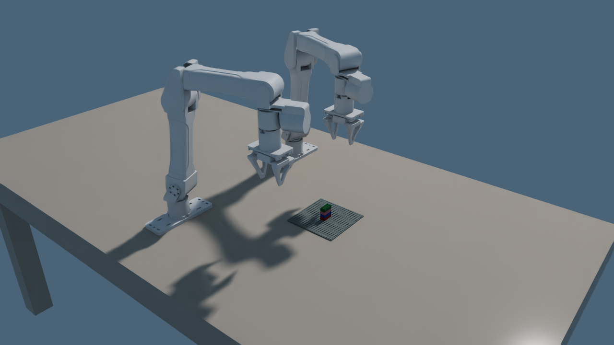
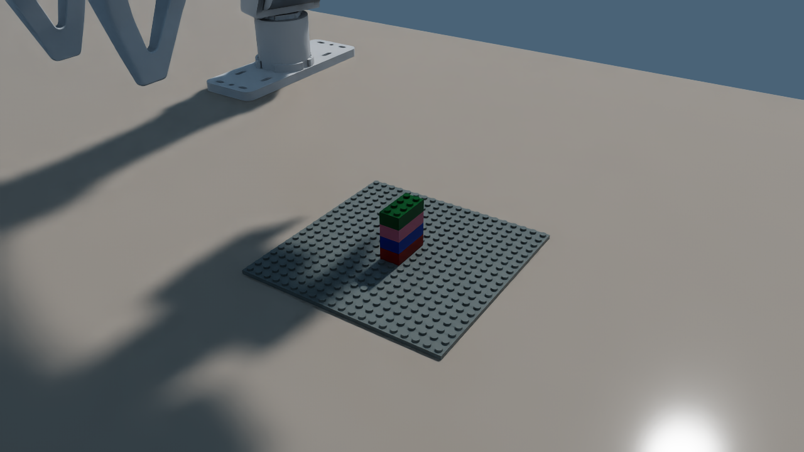
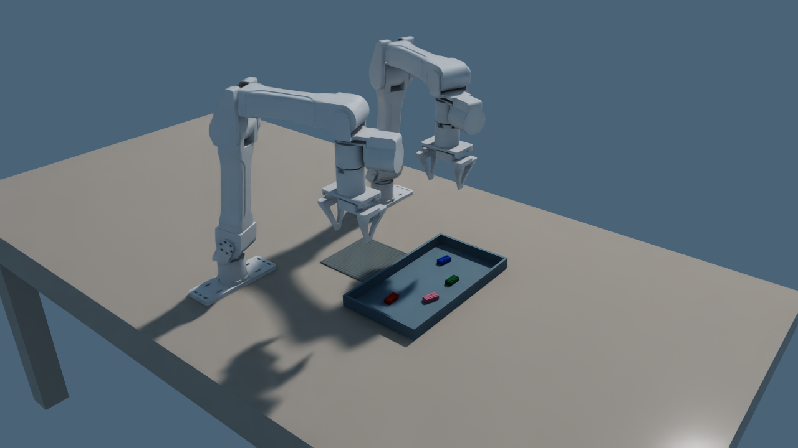
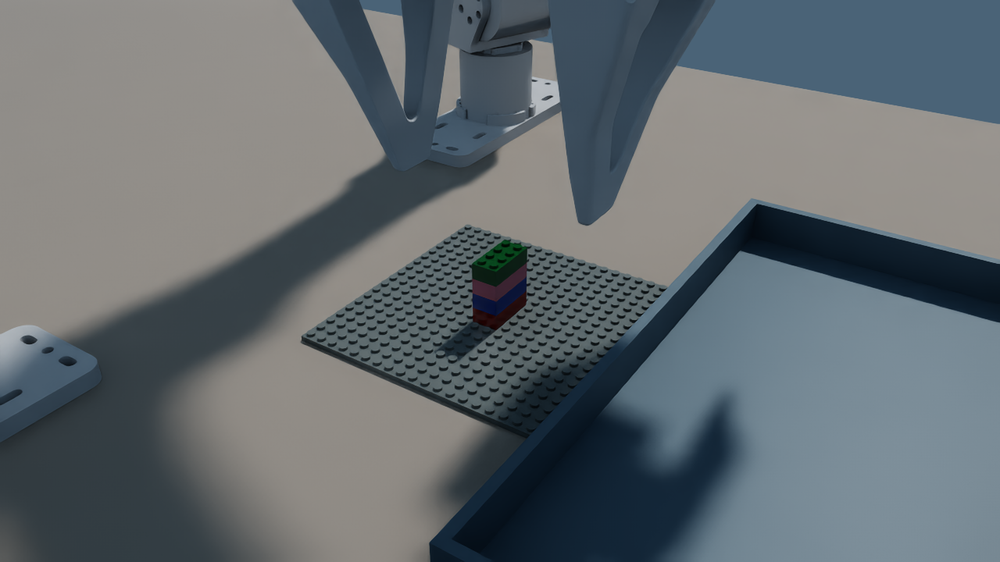

# Dual YAM assembly with Qwen

This demo loads two fixed-base I2RT YAM v1 arms, four 2×4 bricks and a baseplate. A local **Qwen3.5-0.8B** generates a short Python program that selects the ordered assembly operations and the arm for each operation. Numerical inverse kinematics and joint position drives execute those operations. Fingers physically grasp the bricks; the native contact detector must create each connection. No brick is teleported or attached by the policy.

The original Franka demo is unchanged. This is a simulation prototype; the drive settings are not calibrated for hardware, and the Cartesian paths are not a general collision-avoidance planner. Arms act sequentially and return to their parking positions between operations.

## Generate a program

First complete the repository's Linux/Isaac Sim 5.1 setup. Run Qwen in a separate environment so its Transformers dependency does not alter the simulation environment. Tested inference dependencies are Transformers 5.4.0, PyTorch 2.7.0+cu126, Accelerate 1.13.0, Hugging Face Hub 1.7.1 and Tokenizers 0.22.2.

```sh
uv venv --python 3.11 .venv-qwen
uv pip install --python .venv-qwen/bin/python \
  torch==2.7.0 transformers==5.4.0 accelerate==1.13.0 \
  huggingface-hub==1.7.1 tokenizers==0.22.2
PYTHONPATH=python .venv-qwen/bin/python demos/generate_yam_policy.py \
  --target demos/assemblies/four_brick_tower.json \
  --revision 2fc06364715b967f1860aea9cf38778875588b17 \
  --output outputs/yam
```

The public model needs no API key. The first run downloads the weights. `response.txt` preserves the raw model response, `generation.json` records its revision, prompt and target hash, and `policy.py` contains the validated program. Generation fails if the program is invalid; there is no hand-written fallback. Qwen is released before simulation starts, leaving GPU memory for rendering.

The supported Python subset contains only literal calls such as:

```python
await robot.assemble(stud=0, hole=1, arm="left")
```

Both positional and named arguments are accepted. Imports, loops, expressions, additional methods and arbitrary Python execution are rejected. Every target connection must appear once, with its supporting brick already placed. The interpreter never uses `eval` or `exec`. This is a small code-as-policy interface, not a general Python sandbox. The model uses the supplied scene/target description, not camera-based perception.

## Run the scene

```sh
uv run --no-sync bricksim \
  --/app/window/enabled=false --/isaac/startup/ros_bridge_extension= \
  demos/demo_yam_assembly.py
```

For a scene preview without executing a policy, prefix the command with `YAM_SCENE_ONLY=1`. The demo starts automatically, renders PNGs and requests application exit when complete. If Kit remains alive during shutdown, terminate the identified demo process after checking the saved result.

`YAM_TARGET`, `YAM_POLICY` and `YAM_OUTPUT` override the target JSON, program and output directory respectively. Defaults are `demos/assemblies/four_brick_tower.json`, `outputs/yam/policy.py` and `outputs/yam`. The native topology format specifies part dimensions/colors and stud-to-hole connections. Offsets are in studs; yaw is an integer quarter turn. Baseplate ID 0 is pre-placed. The supplied layout and grasp settings are tuned for the four 2×4 bricks; arbitrary brick inventories or assemblies require reachability and grasp validation.

The official URDF and meshes are vendored with their MIT license and source revision in `resources/robots/yam`. The Isaac URDF importer converts them once into `.cache/yam`. Remove that generated cache after changing the source model or import options.

## Pick from a basket

Set `YAM_BASKET=1` to put the four loose bricks in a shallow basket with a physical floor and four collision walls. `YAM_SEED` chooses a reproducible scatter (default `7`): each brick has a small position variation and a yaw between -20 and +20 degrees. The basket holds one layer of upright, separated 2×4 bricks with IDs 1–4. The baseplate moves beside the basket.

```sh
YAM_BASKET=1 YAM_SEED=7 \
  YAM_POLICY=outputs/yam/policy.py YAM_OUTPUT=outputs/yam-basket \
  uv run --no-sync bricksim \
  --/app/window/enabled=false --/isaac/startup/ros_bridge_extension= \
  demos/demo_yam_assembly.py
```

Use the Qwen-generated policy from the earlier generation step: the target assembly and action interface are unchanged. Before each pick, the controller reads the current simulator poses of all remaining bricks and checks the open-finger footprint against the rim and neighboring bricks. It aligns with the selected brick's observed orientation, grasps with physical contact and lifts vertically before crossing the rim. A failed lift allows one retry after releasing and observing again. Blocked, tilted or stacked picks fail explicitly; they are not skipped. The brick-to-tool transform measured after lifting determines its placement pose. It checks for a connection while pressing, with at most three downward targets (0.5, 1.5 and 2.5 mm). Successful placements still require actual connections and relative alignment.

This uses simulator state, not camera perception. This four-brick mode does not handle overlapping piles, arbitrary inventories or general robot collision planning. The footprint check covers the fingertip approach; the scene and arm paths remain a simulation prototype. `inventory.json` records the seed and actual initial transforms; each successful action in `result.json` records its observed source transform, attempt count, lift distance and press depth. Omitting `YAM_BASKET` retains the tabletop layout.

## Select from fifty identical bricks

Add `YAM_SUPPLY_COUNT=50` to basket mode. The container holds fifty red 2×4 bricks, initialized at varied XY positions and yaw (±30°) in one loose layer and then settled by gravity. The target keeps its four logical placement IDs; each is bound to a distinct physical supply brick selected immediately before grasping. Geometry is interchangeable in this mode; the tower uses the supply's red color.

```sh
YAM_BASKET=1 YAM_SUPPLY_COUNT=50 YAM_SEED=11 \
  YAM_POLICY=outputs/yam/policy.py YAM_OUTPUT=outputs/yam-bulk-basket \
  uv run --no-sync bricksim \
  --/app/window/enabled=false --/isaac/startup/ros_bridge_extension= \
  demos/demo_yam_assembly.py
```

The bulk bin uses a 26 mm finger opening matched to the 16 mm brick width. The selector re-observes all remaining bricks, rejects tilted or covered objects and blocked finger approaches, restricts each arm to its own half of the bin, ranks exposed candidates by height, and screens arm reach before choosing. It aligns the grasp with the selected brick's live pose. If the side grip slips during seating, it releases the brick and applies a bounded downward press with closed fingertips, then requires the same native connection and alignment checks. Successful actions record `supply_id`, rejection explanations, actual source transform and remaining supply count. A completed tower leaves 46 unconsumed supply IDs. If no supported grasp is available, the run fails explicitly; it does not relocate bricks to clear a path.

Bulk candidate selection keeps an extra 2 mm of clearance and reobserves the bin after checking reachability. Initial bricks have at least 10 mm of separating-axis spacing; individual XY positions and yaw still vary. If every reachable candidate is blocked, the demo reports failure before moving.

This is a simulation prototype with known object poses. It supports exposed, nearly upright picks from a shallow supply; it does not yet reorient arbitrary sideways bricks, use camera estimates, untangle connected clusters or plan collision-free paths for every arm link. The existing four-brick basket and tabletop modes are unchanged.

<<<<<<< HEAD
## Compact cluttered supply

Set `YAM_BASKET_LAYOUT=compact` with `YAM_BASKET=1 YAM_SUPPLY_COUNT=50` to shrink the inner bin from 315×600 mm to 180×240 mm (23% of its previous floor area). The 75 mm walls contain fifty identical red 2×4 bricks. They start in five collision-free randomized layers and fall under gravity into a cluttered pile. Yaw covers a full turn; no physical source ID is reserved for a tower step.

```sh
YAM_BASKET=1 YAM_SUPPLY_COUNT=50 YAM_BASKET_LAYOUT=compact YAM_SEED=7 \
  YAM_POLICY=outputs/yam/policy.py YAM_OUTPUT=outputs/yam-clutter \
  uv run --no-sync bricksim \
  --/app/window/enabled=false --/isaac/startup/ros_bridge_extension= \
  demos/demo_yam_assembly.py
```

Add `YAM_SCENE_ONLY=1` for a settled scene preview. `inventory.json` records the bin dimensions and actual settled poses; `yam-basket.png` provides a close-up of the settled clutter. The existing shallow mode remains the default when this setting is omitted.

Compact clutter is a harder scene, not a claim of arbitrary bin picking. The controller still requires a nearly upright source, clear fingers and reachable poses. It conservatively projects all eight corners of tilted neighboring bricks when checking obstruction. It fails explicitly when no supported source remains; it does not spread, teleport or reserve easy bricks. The controller cannot yet reorient sideways pieces or separate connected clusters. Physical compact-mode validation is pending.
=======
## Bulk validation evidence

The final seed-11 GPU run against commit `2bfd4f4` completed all four connections using supply IDs 123, 139, 117 and 143, with first-attempt lifts of 99.7–99.9 mm and 46 unused sources remaining in the bin. The optional top press was not needed in that successful run. All 36 focused tests, repository-wide lint and type checks passed. Results, source manifests, validation logs and before/after images are saved under [bulk/](bulk/). The pose-read comparison reproduced ten incorrect temporary-view readings across 400 stationary-scene queries; direct Fabric primitive reads remained consistent to floating-point precision. The controller now uses the direct reader for both supply and robot poses.

The seed-7 evidence was captured before that reader correction and is retained as an earlier successful physical run, rather than a final-source reliability claim. A previous seed-11 trial failed during side pressing, so contact outcomes can vary even with the same nominal scene. These examples do not establish production reliability.
>>>>>>> origin/codex/yam-bulk-basket

## Inspect the result

- `inventory.json`: embodiment, joints, part IDs, dimensions, colors and prim paths.
- `yam-scene.png`: both arms and the initial disconnected bricks.
- `step-N.png`: image after a verified placement.
- `result.json`: `success`, `failed` or `scene_only`, plus action outcomes. Only `success` means all requested connections were checked.
- `yam-result.png` or `yam-failure.png`: final rendered evidence.
- `yam-tower.png`: close-up after completion.

Grasp checks require a brick to rise by at least 65 mm. Placement checks require the native physical connection and the requested relative pose (within 2 mm and 5 degrees). Motion checks enforce joint limits and position/orientation error; startup compares the URDF flange transform with the imported robot. Model generation alone never counts as task success.

The arms use SI units, WXYZ quaternions at simulator boundaries and column-vector transforms internally. The tool is 144.65 mm along flange +Z, measured from the source fingertip meshes. Finger separation is minus twice the prismatic joint position. Imported visual meshes supply convex-decomposition collisions; self-collision is disabled. Arm gains are 100000/1000 with an 80 Nm drive limit; finger gains are 2000/50 with a 15 N limit. These are simulation settings, not manufacturer specifications.

## Checks

```sh
uv run --no-sync pytest --noconftest -q python/tests/test_yam_policy.py python/tests/test_yam_kinematics.py python/tests/test_yam_basket.py
uv run --no-sync ruff check python/bricksim/cap demos/*yam*.py python/tests/test_yam*
uv run --no-sync bricksim-type-configs -y
uv run --no-sync ty check python/bricksim/cap demos/*yam*.py
```

The NVIDIA 595 RunPod used for validation required an external Vulkan Profiles driver workaround already configured in its `.runtime/environment.sh`; source that file there before launching. That machine-specific workaround is not part of this feature.

## Verified run

On 2026-10-27 UTC, Qwen3.5-0.8B generated the four-call policy in [generated-policy.txt](generated-policy.txt). Both YAM arms physically assembled the requested tower on an RTX 4000 Ada RunPod running Isaac Sim 5.1 and Ubuntu 24.04. All four connections passed both connectivity and relative-pose checks. The [result](result.json) and [validation log](validation.log) record the outcome. All 15 tests and repository-wide ruff/ty checks passed; local Vulkan build artifacts were excluded from source checks.





## Verified basket runs

On 2026-10-27 UTC, both scattered layouts (seeds **7** and **11**) completed the four-brick tower using the same Qwen3.5-0.8B program. All eight picks succeeded on their first attempt and lifted their bricks approximately 100 mm. Every requested physical connection and relative-pose check passed. Each placement connected at the initial 0.5 mm press target; the deeper press fallback and failed-lift retry were not exercised in these successful runs. These two runs demonstrate the supported scene, not a measured production reliability rate.

The [seed-7 result](basket/result-seed7.json), [seed-11 result](basket/result-seed11.json), [validation log](basket/validation.log), and [tested source hashes](basket/source-hashes.json) preserve evidence. All 23 policy, kinematics and basket tests passed, including 100 geometric layouts and explicit blocked/tilted/stacked cases. Repository-wide ruff and ty passed. The actual seed-7 viewport was recorded at 1280×720; the 2× playback video was delivered with the task.





## Assemble an eleven-brick heart

The [separate heart demonstration](HEART.md) uses exactly two YAM arms, six 2×4 bricks and five 2×2 bricks from organized tabletop sources, with a fresh Qwen3.5-0.8B policy and a support baseplate.
